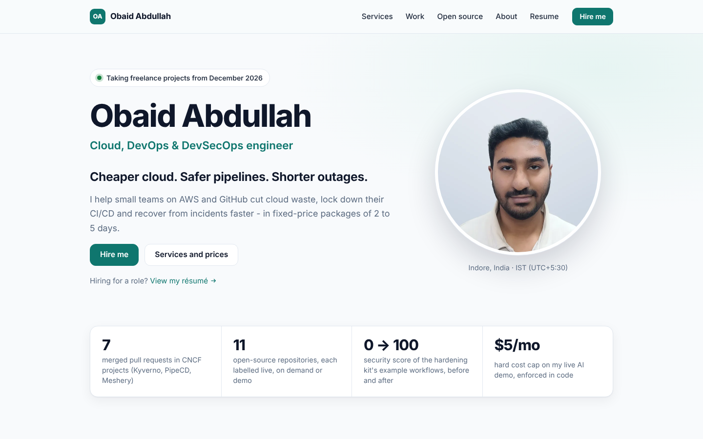

# Portfolio

[](https://github.com/ObaidAbdullah16/portfolio/actions/workflows/ci.yml)
[](https://github.com/ObaidAbdullah16/portfolio/actions/workflows/deploy.yml)

My services and projects site, live at **https://obaidabdullah.com**: a home page with my photo and the
four most-requested fixed-price services, a page per service (scope, steps, prices, FAQ), nine project
pages, open-source pull requests, an about page, a recruiter résumé (HTML + one-page PDF without a phone
number), a contact page with a contact form and a free-scan request form (Web3Forms, no backend), and
the free tools (the Bedrock Bill-Shock Calculator and the IncidentScribe live demo).

Static HTML generated by a small Python script (standard library only), hosted on **private S3 +
CloudFront** (Origin Access Control, strict security headers, HTTPS only, a CloudFront Function that
serves `index.html` for directory URLs). No cookies, no tracking, no third-party scripts; the font
(Inter, OFL) is self-hosted.



## Edit the content

Everything you would want to change is in [`content/site.json`](content/site.json):

| Field | What it controls |
|---|---|
| `name`, `role`, `headline`, `tagline`, `availability`, `location` | The first screen of the home page |
| `photo` | The headshot (files in `site/assets/img/`: 320 and 640 px, WebP + JPEG) |
| `contact.email`, `linkedin`, `github` | Contact links everywhere |
| `contact.calendar`, `contact.calendar_scan` | Cal.com booking links ("Book a 15-minute call", "Book a free scan review") - empty = hidden |
| `contact.web3forms_key` | Turns on the contact and free-scan forms (free key from web3forms.com; it is meant to be public). Empty = email links instead |
| `featured`, `selected_work` | Which services and projects the home page shows |
| `services[]` | Each service: `short`, `highlights`, prices, and its `case_study` (situation, problem, solution, steps, evidence) |
| `projects[]` | Each project: `short`, `summary`, links (add demo video URLs in `"video"` when you record them) |
| `open_source`, `resume`, `faq`, `about`, `proof_bar` | The open-source, résumé, FAQ and about content |

Case studies are built from demo projects with synthetic data and say so on the page.

```bash
python3 build.py                     # -> dist/
python3 -m http.server -d dist 8000  # preview at http://localhost:8000
python3 tests/check_site.py          # build + check links, HTML and the content data
bash sync-demos.sh                   # refresh sample reports from the sibling project folders
```

`site/assets/Obaid-Abdullah-Resume.pdf` (printed from `resume.html` with the print stylesheet) and
`site/assets/og.jpg` (the link-preview image) are static files: regenerate them when the résumé changes.

## Deploy

Needs the shared AWS setup from `aws-foundation` (state bucket, OIDC role) and the
`AWS_ROLE_ARN` repository variable (set when you start the foundation: `bash _setup/projects.sh up foundation`).

* **Automatic:** every push to `main` that changes the site runs **Deploy**.
* **Manual:** Actions → Deploy → Run workflow, or locally `bash scripts/up.sh`.
* **AWS project account (new AWS sign-up):** GitHub cannot log in to AWS there, so Deploy skips itself;
  deploy from the laptop with `bash scripts/up.sh` (or `bash _setup/projects.sh up portfolio`).
* The deploy reads `/incidentscribe/api-url` from SSM and connects the live
  IncidentScribe demo page. Deploy IncidentScribe first, or re-run Deploy afterwards.

| Command | What it does |
|---|---|
| `bash scripts/up.sh` | Terraform + build + upload + CDN invalidation (idempotent); uses your domain from `../_setup/config.env` once it points at Route 53 |
| `bash scripts/status.sh` | URL, HTTP status, last upload |
| `bash scripts/down.sh` | Website offline (S3 + CloudFront + certificate). The Route 53 zone stays, so the domain and email keep working |
| `bash scripts/down.sh --all` | Also deletes the Route 53 hosted zone (asks you to type the domain); setting it up again means new name servers at the registrar |

Custom domain with free HTTPS (a Route 53 hosted zone costs $0.50/month). For **obaidabdullah.com**
(Project Hosting Guides / 03 has the click-by-click version):

1. `bash scripts/domain-setup.sh obaidabdullah.com --apply` creates the Route 53 hosted zone (or finds it), adds
   email-forwarding records (ImprovMX MX + SPF), DMARC at `p=none` and a CAA record for Amazon, saves
   `PORTFOLIO_DOMAIN` / `PORTFOLIO_ZONE_ID` in `../_setup/config.env`, and prints the four name servers.
   Run it without `--apply` first to see what it would do.
2. Copy the four name servers into the registrar's "custom DNS / nameservers" setting and wait until
   `dig NS obaidabdullah.com +short` shows them.
3. `bash scripts/domain-setup.sh obaidabdullah.com --connect` checks the name servers, sets the repository
   variables (`PORTFOLIO_DOMAIN`, `PORTFOLIO_ZONE_ID`, `PORTFOLIO_EXTRA_DOMAINS` here,
   `INCIDENTSCRIBE_ALLOWED_ORIGINS` on incidentscribe-ai, `PORTFOLIO_URL` on bedrock-cost-calculator) and deploys:
   Terraform issues the certificate, validates it in Route 53 and points both names at CloudFront.
4. Locally, `bash scripts/up.sh` reads the same settings from `../_setup/config.env`.

`content/site.json` uses `https://obaidabdullah.com` (canonical links, sitemap, link previews) and
`hello@obaidabdullah.com`.

## Cost

Always on, practically free: CloudFront's always-free tier (1 TB, 10 million
requests and 2 million CloudFront Function invocations per month) and a few MB of
S3 storage.

## License

Code: MIT. Content (text about me and my services): all rights reserved.
